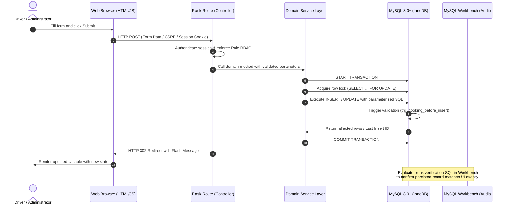

# END-TO-END DATA FLOW & LIFECYCLE SPECIFICATION
## EV Charging Station Management System — Major Upgrade 2.0
**Target Environment:** Python 3.13 / Flask 3.1.2 / MySQL 8.0+ (InnoDB)  
**File:** [docs/data_flow.md](file:///c:/Users/Surya%20Rao/Desktop/DBCAP/docs/data_flow.md)

---

## 1. Unified Architectural Data Flow

Every state-changing user operation follows a rigorous, transactional sequence:



---

## 2. Detailed Data Lifecycle by Major Workflow

### Workflow 1: Driver Registration
1. **Frontend Trigger:** `/register` form (`app/templates/auth/register.html`).
2. **Backend Route:** `POST /register` (`app/routes/auth.py`).
3. **Validation & Business Logic:**
   - Validates that email is well-formed and unique via `SELECT user_id FROM Users WHERE email = %s`.
   - Validates password length >= 6 characters and password confirmation match.
   - Generates PBKDF2/scrypt password hash using `generate_password_hash`.
4. **Database Execution:**
   - Runs `INSERT INTO Users (full_name, email, phone, password_hash, role, account_status) VALUES (...)`.
5. **Tables Read / Written:**
   - Read: `Users` (uniqueness check).
   - Written: `Users` (1 row inserted).
6. **Response:** Redirects to `/login` with success banner.
7. **Workbench Verification:**
   ```sql
   SELECT user_id, full_name, email, role, account_status, created_at 
   FROM Users ORDER BY user_id DESC LIMIT 1;
   ```

---

### Workflow 2: Electric Vehicle Registration
1. **Frontend Trigger:** `/vehicles` form modal (`app/templates/owner/vehicles.html`).
2. **Backend Route:** `POST /vehicles` (`app/routes/owner.py`).
3. **Validation & Business Logic:**
   - Enforces authenticated driver session (`user_id = session["user_id"]`).
   - Validates registration number uniqueness.
   - Enforces positive battery capacity (`battery_capacity_kwh > 0`).
4. **Database Execution:**
   - Runs `INSERT INTO Vehicles (user_id, registration_no, make, model, battery_capacity_kwh) VALUES (...)`.
5. **Tables Read / Written:**
   - Read: `Vehicles` (uniqueness check).
   - Written: `Vehicles` (1 row inserted).
6. **Response:** Redirects to `/vehicles` with new vehicle card rendered.
7. **Workbench Verification:**
   ```sql
   SELECT v.vehicle_id, v.registration_no, v.make, v.model, u.full_name AS owner_name 
   FROM Vehicles v JOIN Users u ON v.user_id = u.user_id 
   ORDER BY v.vehicle_id DESC LIMIT 1;
   ```

---

### Workflow 3: Station Discovery & Dispenser Selection
1. **Frontend Trigger:** `/stations` search bar or `/stations/<id>` detail view.
2. **Backend Route:** `GET /stations` or `GET /stations/<int:station_id>` (`app/routes/owner.py`).
3. **Validation & Business Logic:**
   - Query filters by city, connector type, and station name.
4. **Database Execution (Read-Only):**
   ```sql
   SELECT s.*, COUNT(cp.point_id) AS total_points,
          SUM(CASE WHEN cp.point_status = 'AVAILABLE' THEN 1 ELSE 0 END) AS available_points
   FROM Stations s
   LEFT JOIN ChargingPoints cp ON s.station_id = cp.station_id
   GROUP BY s.station_id;
   ```
5. **Tables Read:** `Stations`, `ChargingPoints`.
6. **Response:** Renders interactive station cards with live available point badges.

---

### Workflow 4: Booking Creation (Concurrency Row Lock)
1. **Frontend Trigger:** `/book` form (`app/templates/owner/book.html`).
2. **Backend Route:** `POST /book` (`app/routes/owner.py`).
3. **Validation & Business Logic:**
   - Enforces start time in future (`start_at > NOW()`).
   - Enforces positive duration (`end_at > start_at`).
   - Enforces vehicle ownership (`Vehicles.user_id == session["user_id"]`).
4. **Database Transaction:**
   ```sql
   START TRANSACTION;
   -- 1. Lock dispenser row
   SELECT point_id, point_status FROM ChargingPoints WHERE point_id = %s FOR UPDATE;
   -- 2. Verify no active overlapping booking exists
   SELECT COUNT(*) AS conflicts FROM Bookings 
   WHERE point_id = %s AND booking_status IN ('PENDING', 'CONFIRMED')
     AND (start_at < %s AND end_at > %s);
   -- 3. If conflicts == 0, insert booking
   INSERT INTO Bookings (user_id, vehicle_id, point_id, start_at, end_at, booking_status) VALUES (...);
   COMMIT;
   ```
5. **Tables Read / Written:**
   - Read: `ChargingPoints`, `Vehicles`, `Bookings`.
   - Written: `Bookings` (1 row inserted).
6. **Response:** Redirects to `/bookings` with confirmation.
7. **Workbench Verification:**
   ```sql
   SELECT b.booking_id, u.full_name, cp.point_code, b.start_at, b.end_at, b.booking_status 
   FROM Bookings b
   JOIN Users u ON b.user_id = u.user_id
   JOIN ChargingPoints cp ON b.point_id = cp.point_id
   ORDER BY b.booking_id DESC LIMIT 1;
   ```

---

### Workflow 5: Booking Cancellation
1. **Frontend Trigger:** Cancel button on `/bookings`.
2. **Backend Route:** `POST /bookings/<int:booking_id>/cancel` (`app/routes/owner.py`).
3. **Validation & Business Logic:**
   - Verifies driver owns the booking (`b.user_id == session["user_id"]`).
   - Verifies booking status is eligible for cancellation (`PENDING` or `CONFIRMED`).
4. **Database Execution:**
   - Runs `UPDATE Bookings SET booking_status = 'CANCELLED' WHERE booking_id = %s`.
5. **Tables Read / Written:** `Bookings`.
6. **Response:** Redirects to `/bookings` with badge updated to `'CANCELLED'`. Dispenser slot is instantly freed for subsequent reservations.

---

### Workflow 6: Charging Session Initiation & Completion
1. **Frontend Trigger:** "Start Charging" / "Complete Session" buttons on `/sessions`.
2. **Backend Route:** `POST /sessions/<int:booking_id>/start` and `POST /sessions/<int:session_id>/complete`.
3. **Validation & Business Logic:**
   - Verifies booking is in valid state; prevents duplicate session per booking.
   - Calculates energy consumed in kWh and total cost via `CalculateChargingCost(energy_kwh, tariff_per_kwh)`.
4. **Database Transaction (Completion):**
   ```sql
   START TRANSACTION;
   UPDATE ChargingSessions 
   SET end_at = NOW(), energy_kwh = %s, total_cost = %s, session_status = 'COMPLETED'
   WHERE session_id = %s;
   UPDATE Bookings SET booking_status = 'COMPLETED' WHERE booking_id = %s;
   UPDATE ChargingPoints SET point_status = 'AVAILABLE' WHERE point_id = %s;
   COMMIT;
   ```
5. **Tables Read / Written:** `ChargingSessions`, `Bookings`, `ChargingPoints`, `AuditLogs`.
6. **Workbench Verification:**
   ```sql
   SELECT session_id, booking_id, energy_kwh, tariff_per_kwh, total_cost, session_status 
   FROM ChargingSessions ORDER BY session_id DESC LIMIT 1;
   ```

---

### Workflow 7: Payment Settlement
1. **Frontend Trigger:** "Pay Now" modal on `/payments` or post-session completion.
2. **Backend Route:** `POST /payments/<int:session_id>/pay` (`app/routes/owner.py`).
3. **Validation & Business Logic:**
   - Verifies customer ownership of the session.
   - Checks if successful payment already exists (prevents duplicate payment completion).
   - Generates cryptographically secure, unique transaction reference `TXN-...`.
4. **Database Execution:**
   - Runs `INSERT INTO Payments (session_id, transaction_reference, amount, payment_method, payment_status, paid_at) VALUES (...)`.
5. **Tables Read / Written:**
   - Read: `Payments`, `ChargingSessions`.
   - Written: `Payments` (1 row inserted).
6. **Workbench Verification:**
   ```sql
   SELECT p.payment_id, p.transaction_reference, p.amount, p.payment_method, p.payment_status, p.paid_at 
   FROM Payments p ORDER BY p.payment_id DESC LIMIT 1;
   ```

---

### Workflow 8: Analytical Reports & CSV Data Export
1. **Frontend Trigger:** `/admin/reports` page or "Export CSV" buttons.
2. **Backend Route:** `GET /admin/reports` or `GET /admin/reports/export?type=revenue|energy|utilization`.
3. **Database Execution (Read-Only Aggregations):**
   - Monthly Revenue: `SELECT s.station_name, DATE_FORMAT(p.paid_at, '%Y-%m') AS month, SUM(p.amount) ... GROUP BY ...`
   - Energy Dispensed: `SELECT s.station_name, SUM(cs.energy_kwh) ... GROUP BY ...`
   - Station Utilization: `SELECT s.station_name, COUNT(cs.session_id), SUM(TIMESTAMPDIFF(MINUTE, cs.start_at, cs.end_at))/60.0 ...`
4. **Tables Read:** `Payments`, `ChargingSessions`, `ChargingPoints`, `Stations`, `Bookings`.
5. **Response:** In-browser dashboard tables or direct file download (`Content-Type: text/csv`).
