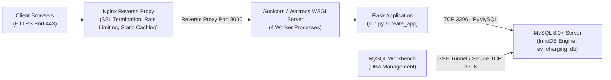

# PRODUCTION DEPLOYMENT & DEVOPS RUNBOOK
## EV Charging Station Management System — Major Upgrade 2.0
**Target Environment:** Python 3.13 / Flask 3.1.2 / MySQL 8.0+ (InnoDB)  
**File:** [docs/deployment.md](file:///c:/Users/Surya%20Rao/Desktop/DBCAP/docs/deployment.md)

---

## 1. Production Architecture Overview

In a production environment, the EV Charging Station Management System is deployed with a production WSGI server behind an Nginx reverse proxy, connecting to a hardened MySQL 8.0+ server.



---

## 2. Environment Prerequisites & Installation

### 2.1 System Requirements
- **Operating System:** Ubuntu 22.04 LTS / Debian 12 / Windows Server 2022
- **Python:** Python 3.11+ (Python 3.13 recommended)
- **Database Engine:** MySQL 8.0.32+ Community / Enterprise Server
- **Memory & Storage:** 2 GB RAM minimum, 20 GB SSD storage

### 2.2 Python Virtual Environment Setup
```bash
# Clone repository and navigate to directory
cd /opt/ev-charging-system

# Create and activate Python virtual environment
python3 -m venv venv
source venv/bin/activate

# Install locked production dependencies
pip install --upgrade pip
pip install -r requirements.txt
pip install gunicorn  # Or waitress on Windows
```

---

## 3. Configuration & Secrets Management

1. Copy `.env.example` to `.env`:
   ```bash
   cp .env.example .env
   ```
2. Generate a cryptographically strong `SECRET_KEY`:
   ```bash
   python3 -c "import secrets; print(secrets.token_hex(32))"
   ```
3. Populate `.env` with production parameters:
   ```ini
   SECRET_KEY=9f8a3c2b1e4d5f6a7b8c9d0e1f2a3b4c5d6e7f8a9b0c1d2e3f4a5b6c7d8e9f0a
   MYSQL_HOST=127.0.0.1
   MYSQL_PORT=3306
   MYSQL_USER=app_backend
   MYSQL_PASSWORD=StrongProductionPassword@2026
   MYSQL_DATABASE=ev_charging_db
   FLASK_ENV=production
   FLASK_DEBUG=0
   ```
4. Set strict file permissions on `.env`:
   ```bash
   chmod 600 .env
   ```

---

## 4. Database Initialization & Least-Privilege Role Setup

1. Run the standardized database initialization script:
   ```bash
   python init_db.py
   ```
2. Create dedicated least-privilege application user in MySQL Workbench or via MySQL CLI:
   ```sql
   CREATE USER 'app_backend'@'localhost' IDENTIFIED BY 'StrongProductionPassword@2026';
   GRANT app_backend_role TO 'app_backend'@'localhost';
   SET DEFAULT ROLE app_backend_role TO 'app_backend'@'localhost';
   FLUSH PRIVILEGES;
   ```
3. Verify database integrity using `database/08_data_quality_checks.sql`:
   ```bash
   mysql -u root -p ev_charging_db < database/08_data_quality_checks.sql
   ```

---

## 5. WSGI Application Server Configuration

### 5.1 Systemd Service Unit (`/etc/systemd/system/evcharging.service`)
```ini
[Unit]
Description=EV Charging Station Management System (Gunicorn WSGI)
After=network.target mysql.service
Wants=mysql.service

[Service]
User=www-data
Group=www-data
WorkingDirectory=/opt/ev-charging-system
Environment="PATH=/opt/ev-charging-system/venv/bin"
ExecStart=/opt/ev-charging-system/venv/bin/gunicorn \
    --workers 4 \
    --threads 2 \
    --bind 127.0.0.1:8000 \
    --timeout 60 \
    --access-logfile /var/log/evcharging/access.log \
    --error-logfile /var/log/evcharging/error.log \
    run:app

Restart=always
RestartSec=5

[Install]
WantedBy=multi-user.target
```

Enable and start the service:
```bash
sudo systemctl daemon-reload
sudo systemctl enable evcharging
sudo systemctl start evcharging
```

---

## 6. Nginx Reverse Proxy & SSL Configuration

```nginx
server {
    listen 80;
    server_name evcharge.yourdomain.com;
    return 301 https://$host$request_uri;
}

server {
    listen 443 ssl http2;
    server_name evcharge.yourdomain.com;

    ssl_certificate /etc/letsencrypt/live/evcharge.yourdomain.com/fullchain.pem;
    ssl_certificate_key /etc/letsencrypt/live/evcharge.yourdomain.com/privkey.pem;
    ssl_protocols TLSv1.2 TLSv1.3;
    ssl_ciphers HIGH:!aNULL:!MD5;

    # Static assets caching
    location /static/ {
        alias /opt/ev-charging-system/app/static/;
        expires 30d;
        add_header Cache-Control "public, no-transform";
    }

    # Proxy to Flask WSGI
    location / {
        proxy_pass http://127.0.0.1:8000;
        proxy_set_header Host $host;
        proxy_set_header X-Real-IP $remote_addr;
        proxy_set_header X-Forwarded-For $proxy_add_x_forwarded_for;
        proxy_set_header X-Forwarded-Proto $scheme;
    }
}
```

---

## 7. Automated Daily Database Backups (Cron)

Set up an automated daily backup cron at 02:00 AM using `mysqldump`:

```bash
# Edit crontab
crontab -e
```

Add the automated backup job:
```cron
0 2 * * * /usr/bin/mysqldump -u root -p'YourPassword' --single-transaction --routines --triggers ev_charging_db | gzip > /opt/backups/ev_charging_db_$(date +\%Y\%m\%d).sql.gz && find /opt/backups -type f -mtime +30 -delete
```

---

## 8. Health Check & Observability Endpoints

| Endpoint | Access Level | Description |
| :--- | :--- | :--- |
| **`GET /api/health`** | Public / Monitoring | Returns `{ "status": "HEALTHY", "database_connected": true, "database_name": "<active_db>" }` with HTTP 200. Zero secrets exposed. |
| **`GET /admin/system-health`** | Admin Only | Full runtime telemetry: MySQL version, active connections, thread cache, uptime, memory buffer hit ratios, and table record counts. |
| **`GET /admin/audit-logs`** | Admin Only | Live audit trail of all administrative events, user toggles, station modifications, and system configuration adjustments. |
